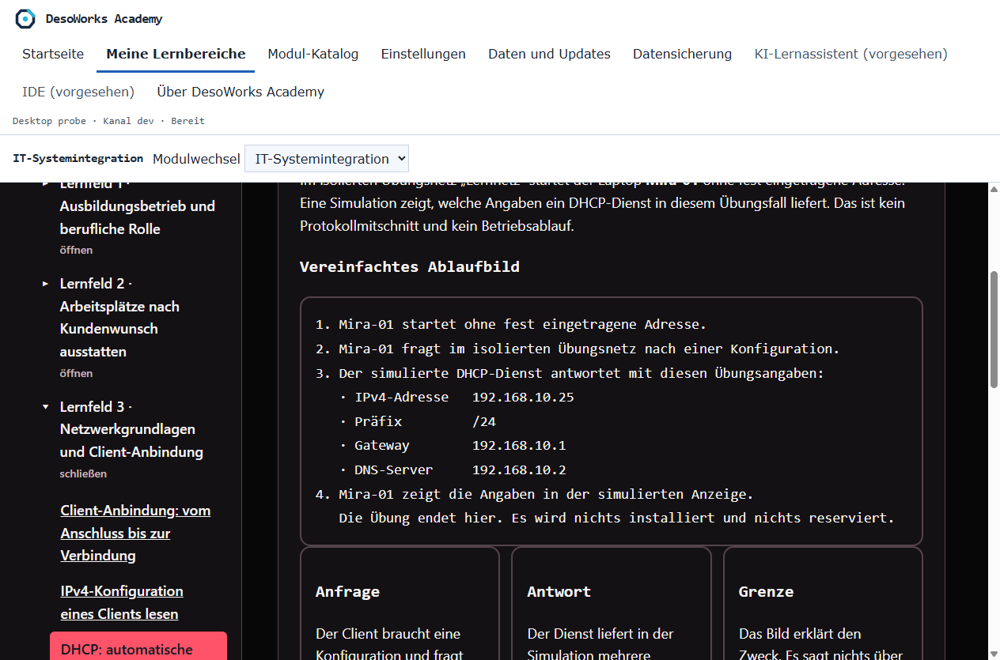
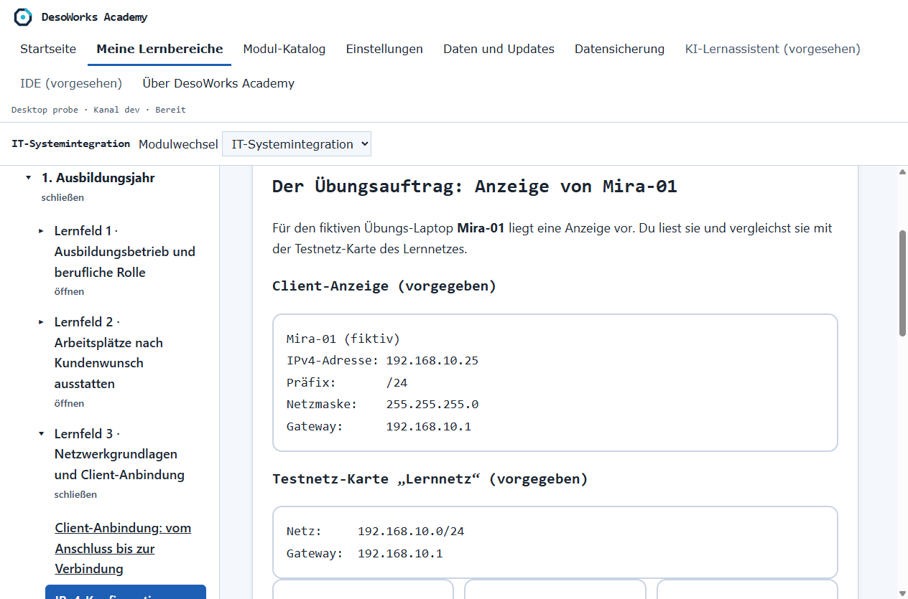
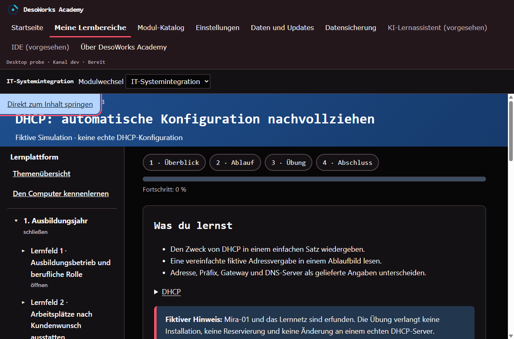

# Design Harmony – Etappe 2C

**Status:** fünf LF3-Seiten umgestellt und im Academy-iframe gemessen. Eingeschränkt. Keine Produktfreigabe. Keine WCAG-Freigabe. Kein Rollout auf andere Lernfelder. Kein Commit.

**HEAD:** `46283bf` auf `feature/phase-n1-release-connectivity`. **main:** `2e704e3`. Kein Push, kein Merge, keine Installation auf dem Benutzerprofil, keine App-ID-Änderung, kein Stable.

Die Mission DESIGN HARMONY bleibt offen.

## Was geändert wurde

Nur der lokale `<style>`-Block in fünf Dateien unter `modules/it-systemintegration/web/module/`. Reihenfolge nach `DESIGN-HARMONY-2C-REIHENFOLGE.md`:

1. `lf3-dhcp.html` – `.step`, `.opt`, `.skizze`
2. `lf3-dns.html` – `.step`, `.opt`, `.skizze`
3. `lf3-verbindung-eingrenzen.html` – `.step`, `.opt`, `.skizze`
4. `lf3-fehlerbild-protokoll.html` – `.step`, `.opt`, `.skizze`
5. `lf3-ipv4-konfiguration.html` – `.step`, `.opt`, `.karte`

`var(--flaeche,#fff)` ist dort weg. Fläche, Text und Rahmen nutzen `--farbe-flaeche`, `--farbe-text` und `--farbe-rahmen`. Der Fokus der Auswahlkarte nutzt `--farbe-akzent` mit `outline-offset: 2px`. Gewählte Antworten bekommen denselben Akzentrahmen und `font-weight: 700`, wie der Pilot. Keine neuen Hex-Farben. Text, ARIA, Skripte und `.result` sind unangetastet.

Nicht angefasst: `lf3-client-anbindung.html` (Pilot aus 2A), `lf3-lernziel.html`, `lf3-abnahme.html`, andere Lernfelder, `src/`, Update, Signatur, App-ID.

Der Nutzlastindex wurde mit `scripts/regenerate-payload-index.js` aus den Git-Blobs nachgezogen, nicht von Hand. 249 Einträge, 0 Hash-Abweichungen zur Arbeitskopie. `sizeBytes` bleibt 62017. Nichts ist gestagt. Ein Teilcommit ohne den Index würde die Installationsprüfung ablehnen.

## Prüfung je Lernseite

Verstecktes Electron-Fenster, echtes Protokoll, echte Shell, temporäres Datenverzeichnis. Die Installation des Commanders lief nicht mit. Modul `desoworks.it-systemintegration` 1.0.1, Zustand `active`. Die Zeile `updates.status is not a function` kommt vom Prüfstub.

Gemessen an `.skizze` bzw. `.karte` im iframe:

| Seite | Dunkel | Hell | Kontrast |
| --- | --- | --- | --- |
| dhcp | 17,15:1 auf `#141114` | 15,65:1 auf Weiß | 21:1, Text schwarz |
| dns | 17,15:1 | 15,65:1 | 21:1 |
| verbindung-eingrenzen | 17,15:1 | 15,65:1 | 21:1 |
| fehlerbild-protokoll | 17,15:1 | 15,65:1 | 21:1 |
| ipv4-konfiguration | 17,15:1 | 15,65:1 | 21:1 |

Dunkeltext `rgb(247, 244, 245)` auf Knight-Fläche `rgb(20, 17, 20)`. Helltext `rgb(27, 36, 48)`. Auf allen fünf Seiten: `data-academy-theme` gesetzt, nach `data-theme` gespiegelt, Darstellungswahl `disabled`. Kein horizontales Überlaufen bei 100 %, 150 % und 200 % Zoom (`overflowX` false).

Die Skizzen wurden danach im sichtbaren Fenster aufgenommen, indem der Ablaufschritt über den vorhandenen Knopf geöffnet wurde. Das ist kein Tastaturnachweis.

Weitere Aufnahmen liegen daneben: `lf3-dns-skizze-dunkel.png`, `lf3-verbindung-eingrenzen-skizze-dunkel.png`, `lf3-fehlerbild-protokoll-skizze-dunkel.png` und die Hell-Pendants.

`node --test tests/design-harmony-2b-theme.test.js tests/phase-k-updates.test.js tests/phase-m-updates.test.js`: 31 bestanden, 0 fehlgeschlagen, Exit 0.

## Fokus und Tastatur

Zwölf Tabs von der Shell führen in den iframe. Der Skip-Link „Direkt zum Inhalt springen“ hat dort einen sichtbaren Rahmen, 3 px solid `rgb(255, 83, 105)`, Knight-Akzent.

Return, Enter und der folgende Tab haben diesen Fokus in der Probe nicht verlassen. Sobald das iframe-Element im Parent fokussiert ist, kommen die weiteren synthetischen Tasten nicht zuverlässig im Frame an. Das ist eine Grenze der Probe, kein Nachweis, dass Enter den Sprung auslöst, und kein Nachweis des nächsten Tab-Stopps.

`MAIN` wurde in diesem Lauf nicht per Tastatur erreicht. Der Codebefund bleibt: ein Schrittwechsel ruft `main.focus()` auf, und `styles.css` setzt für `main:focus` `outline: none`. Ein gesetzter Fokus im DOM ist keine Freigabe. WCAG-Tastatur ist nicht bestanden.

## Was sonst geprüft wurde, und was nicht

- Textgröße 150 % und größere Abstände überlebten einen Reload im iframe. Der gespeicherte Modulwert `theme: hell` hat den Academy-Modus `dunkel` nicht überschrieben.
- `academy.theme` war nach einem zweiten Prozess auf demselben temporären Verzeichnis noch `kontrast`. Ein gesetzter Modulfortschritt ebenfalls. Der Lektionsschlüssel `it-ausbildung.lf3-dhcp.v1` wurde nicht geschrieben. Der Erhalt eines Seiten-Lernstands ist damit nicht belegt.
- Screenreader: nicht gestartet. Kein Narrator-, NVDA- oder JAWS-Prozess. `role="img"` und `aria-label` stehen im HTML. Das ist keine Screenreader-Stichprobe.
- 200 % Zoom: kein horizontales Überlaufen, Shell-Navigation bricht um. Die linke Modulnavigation war nach dem Scrollen zur Fläche nicht im gemessenen Viewport. Das ist kein bestandenes WCAG 1.4.10.
- Kontrastmodus ist implementiert und an den fünf Flächen gemessen, nicht als vollständiger Bedienlauf.

## Umfang, Sprache, Sicherheit

SMITH: fünf Seiten korrigiert, 15 weiße Fallbacks entfernt, ein Fehlerbild. 122 weiße `var(--flaeche,#fff)`-Stellen in anderen Dateien bleiben Kandidaten. Eigene Zählung im Modulbaum: 122 weiße Fallbacks, 123 `var(--flaeche`-Treffer. Keine Gleichsetzung mit Fehlern. Details: `DESIGN-HARMONY-2C-UMFANG.md`.

C-3PO: acht LF3-Seiten gelesen, 14 Sprach- und LRS-Befunde, keine Lernzieländerung. Die fünf Skizzen haben `role="img"` und ein `aria-label`. Die Ausgabe mit einem Screenreader fehlt. `DESIGN-HARMONY-2C-DIDAKTIK.md`.

ROBOCOP: kein kritischer, hoher oder mittlerer Befund am 2C-Diff. Kein neues `postMessage`, keine gelockerte CSP, keine App-ID, keine Signaturänderung. Zwei niedrige Hinweise: Index und HTML müssen zusammen committed werden, und der Arbeitsbaum mischt noch 2B. `DESIGN-HARMONY-2C-SECURITY.md`.

GLaDOS: eingeschränkt. `DESIGN-HARMONY-2C-QA.md`.

## Nicht erledigt

Kein Commit. Kein Push. Kein Merge nach `main`. Keine Installation. Keine Stable-Veröffentlichung. Andere Lernfelder sind nicht freigegeben.

Der nächste sinnvolle Schritt ist kein automatischer Massenlauf. Erst der offene Tastaturbefund an `MAIN`, dann ein einzelner weiterer Lernfeld-Pilot, wenn der Commander das will.
