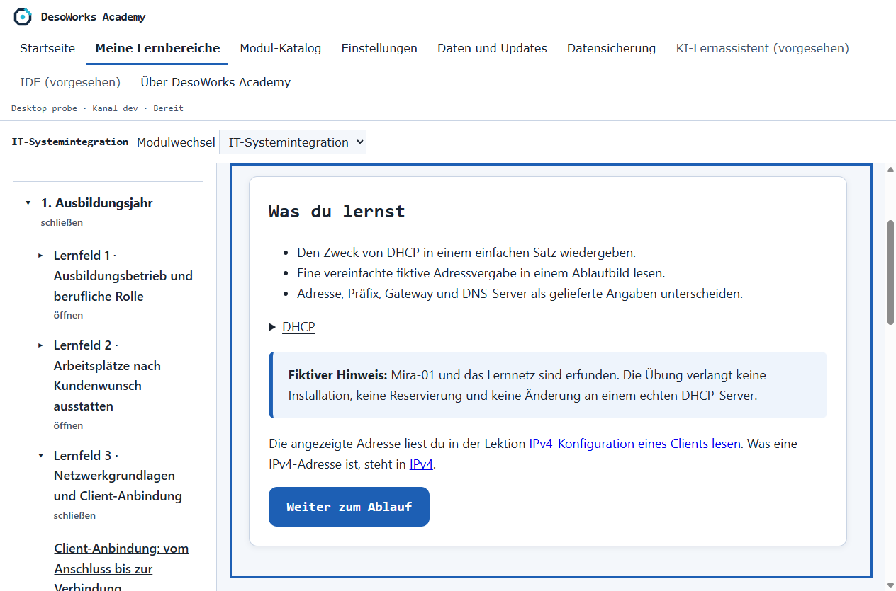
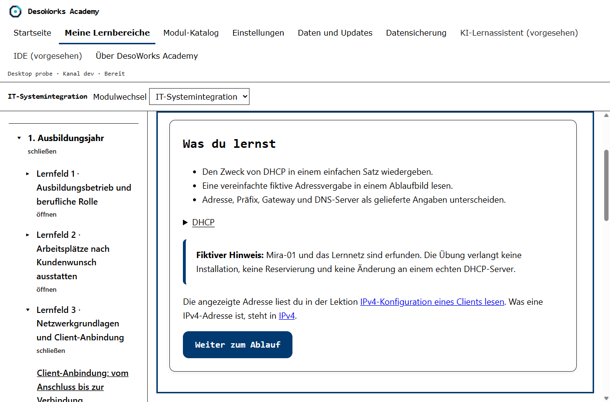
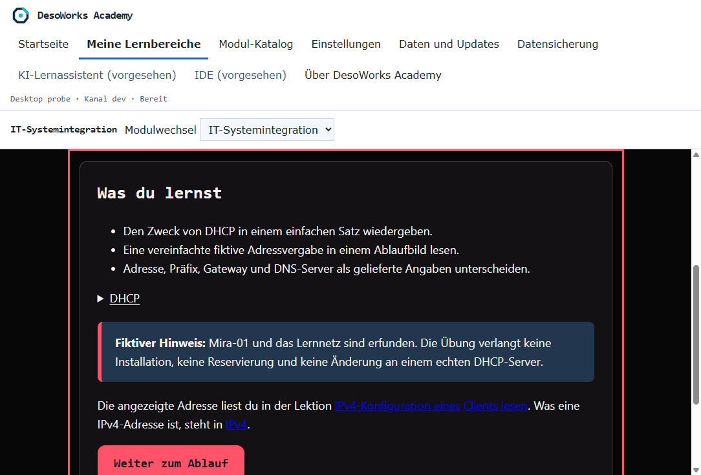

# Design Harmony – Etappe 2D

**Status:** eingeschränkt geprüft. Keine Produktfreigabe. Keine WCAG-Freigabe. Kein Rollout auf weitere Lernfelder. Kein Commit.

**HEAD:** `46283bf` auf `feature/phase-n1-release-connectivity`. **main:** `2e704e3`. Kein Push, kein Merge, keine Installation auf dem Benutzerprofil, keine Änderung an App-ID, Signatur oder Updatekanälen.

Die Mission DESIGN HARMONY bleibt offen.

## Was geändert wurde

Nur der sichtbare Fokusring für die sechs bereits angepassten LF3-Seiten. `modules/it-systemintegration/web/css/styles.css` behält `main:focus { outline: none; }` für alle anderen Seiten. Dahinter steht eine Regel nur für diese `data-page`-Werte:

- `lf3-client-anbindung`
- `lf3-dhcp`
- `lf3-dns`
- `lf3-fehlerbild-protokoll`
- `lf3-ipv4-konfiguration`
- `lf3-verbindung-eingrenzen`

`main#main[tabindex="-1"]:focus` bekommt `outline: 3px solid var(--farbe-akzent)` und `outline-offset: -3px`. Keine neue Farbe. Kein JavaScript, kein HTML, keine Shell, keine Sandbox, kein neuer Nachrichtenkanal.

Der Nutzlastindex musste den neuen Hash von `web/css/styles.css` tragen, sonst lehnt die Installation das Paket ab. Das Regenerierskript liest Git-Blobs und hätte die uncommittete Änderung ignoriert. Der Eintrag ist deshalb an der Arbeitskopie gemessen: SHA-256 `97a47a728bbc8c4d2d1816d8ac8c7dfdcab84c2510515b7a5bbcc2395053d035`, 24316 Bytes. `sizeBytes` bleibt 62017. Die Probe hat das Paket angenommen. Nach einem späteren Commit muss der Index erneut gegen die Blobs geprüft werden.

## Tastatur

Geprüft im echten Academy-iframe, verstecktes Electron-Fenster, eigenes Datenverzeichnis. Tab bis zum Skip-Link über `sendInputEvent`. Danach genau ein CDP-`keyDown`/`keyUp`. Im Kinddokument mitgelesene Ereignisse waren `isTrusted: true`. Kein `element.focus()`, kein `dispatchEvent`, kein Klick durch die Probe.

Auf allen sechs Seiten: Tab erreicht „Direkt zum Inhalt springen“. Enter löst den nativen Sprung aus. `focusin` landet auf `MAIN#main`. Der Rahmen ist sichtbar.

| Seite | Nach Enter | Nächster Tab im Inhalt |
| --- | --- | --- |
| client-anbindung | MAIN, 3 px `rgb(255, 83, 105)`, Versatz -3 px | „Client“ |
| dhcp | MAIN, derselbe Rahmen | „DHCP“ |
| dns | MAIN, derselbe Rahmen | „DNS“ |
| fehlerbild-protokoll | MAIN, derselbe Rahmen | „Befund“ |
| ipv4-konfiguration | MAIN, derselbe Rahmen | „Lektion 1: Die IPv4-Adresse“ |
| verbindung-eingrenzen | MAIN, derselbe Rahmen | „Eingrenzung“ |

Ein Shift+Tab von diesem ersten Inhaltselement geht auf den Schrittschalter „4 · Abschluss“, nicht zurück in eine Schleife. `MAIN` hat `tabindex="-1"` und ist kein zusätzlicher Tab-Stopp. Das ist der erwartete Rückweg, keine Falle. Rückwärts verlässt der Fokus den Frame bis zur Shell-Auswahl `#modul-wechsel`. Der Vorwärtsweg bis hinter den Frame ist nicht bis zum Ende geprüft.

Hell und Kontrast, nur DHCP, unmittelbar nach Enter:

Dunkel, Aufnahme vor dem nächsten Tab:

Hell: `solid 3px rgb(29, 95, 180)`. Kontrast: `solid 3px rgb(0, 58, 112)`. Dunkel: `rgb(255, 83, 105) solid 3px`.

Auf DHCP aktiviert Space den Knopf „Weiter zum Ablauf“. Abschnitt `case` wird sichtbar, der Fokus liegt wieder auf `MAIN` mit demselben Rahmen. Space auf „Weiter zur Übung“ öffnet `exercise`, Fokus wieder `MAIN`. Der nächste Tab erreicht `input type="radio"`. Space setzt `checked` auf true. Enter auf diese Knöpfe ist nicht separat belegt. Der Skip-Link reagiert auf Enter. Daraus folgt nicht, dass jeder Knopf Enter ignoriert.

## Darstellung, Zoom, Lesen

Gemessen an `.skizze` auf DHCP im iframe:

| Modus | Text | Fläche | Kontrast |
| --- | --- | --- | --- |
| Dunkel | `rgb(247, 244, 245)` | `rgb(20, 17, 20)` | 17,15:1 |
| Hell | `rgb(27, 36, 48)` | Weiß | 15,65:1 |
| Kontrast | Schwarz | Weiß | 21:1 |

Zoom 150 % und 200 %: kein horizontales Überlaufen im Frame und nicht in der ersten Shell-`nav`. Bei gesetzter Fensterbreite 320 px war `innerWidth` 305, ebenfalls ohne horizontales Überlaufen. Das ist eine Messung, kein bestandenes WCAG 1.4.10. Die Kombination aus 200 % Zoom und Textskala 150 % ist nicht gemessen.

Textskala `1.5` und die Klasse `mehr-abstand` überleben einen Reload. Der gemessene Absatz hatte danach 17 px Schrift und 32,3 px Zeilenhöhe. Die Academy-Darstellung blieb `dunkel`. Die modulinterne Darstellungswahl war deaktiviert. Ein gespeicherter Modulwert hat den Shell-Modus nicht überschrieben.

Screenreader: kein laufender Narrator, kein NVDA, kein JAWS. `role="img"` und `aria-label` an den Skizzen sind Markup, keine Stichprobe. Offen.

## Standard, nicht umgesetzt

C-3PO hat den Soll-Standard in `DESIGN-HARMONY-2D-STANDARD.md` geschrieben. Neun Ja/Nein-Kriterien. Die sechs Aufgaben sind nicht umgeschrieben. Offener Ist-Befund, nicht behoben: die DHCP-Übung zeigt die erwarteten Angaben vor der Aufgabe, und eine falsche Antwort nennt die richtige Aussage direkt.

## Sicherheit

ROBOCOP: kein Befund am CSS-Hunk. Keine `url()`, kein `@import`, keine gelockerte Sandbox, keine CSP-, App-ID- oder Signaturänderung. Der Hash der Arbeitskopie stimmt mit dem Indexeintrag überein. Andere Indexeinträge im Arbeitsbaum stammen aus 2B/2C und sind nicht dieser Patch. `DESIGN-HARMONY-2D-SECURITY.md`.

## Entscheidungsvorlage für den nächsten Rollout

Nicht starten, solange der Commander das Feld nicht benennt.

1. Ein Lernfeld, nicht die übrigen 122 CSS-Kandidaten. Dieselbe Token-Regel wie in 2B/2C, danach dieselbe Tastaturprobe im iframe. Kein Massenlauf.
2. Keine WCAG- oder Produktfreigabe an diesen Rollout hängen. Screenreader, Vorwärtsausstieg aus dem Frame und WCAG 1.4.10 bleiben offen, bis sie gemessen sind.
3. Didaktik nicht im selben Diff umbauen. Der Prüfstandard gilt. Lösungstexte vor der Aufgabe sind eine eigene Entscheidung.
4. Nach einem Commit den Nutzlastindex aus den Git-Blobs neu prüfen. Vorher nicht installieren und nicht mergen.
5. Wenn der Commander kein Feld nennt, bleibt der nächste sinnvolle Schritt der offene Screenreader-Stichprobenweg, nicht ein weiterer CSS-Lauf.
