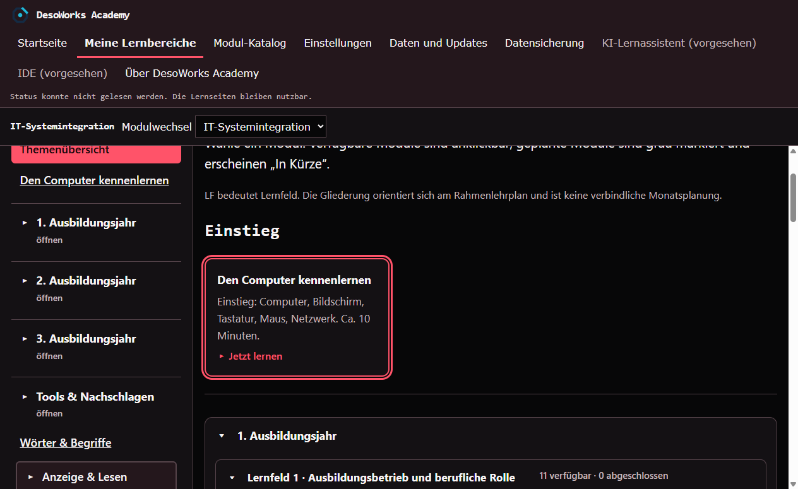
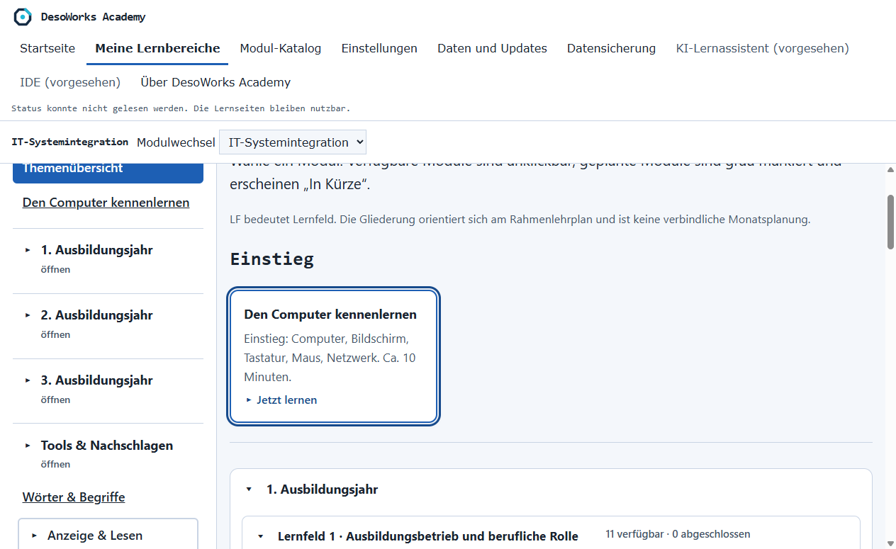
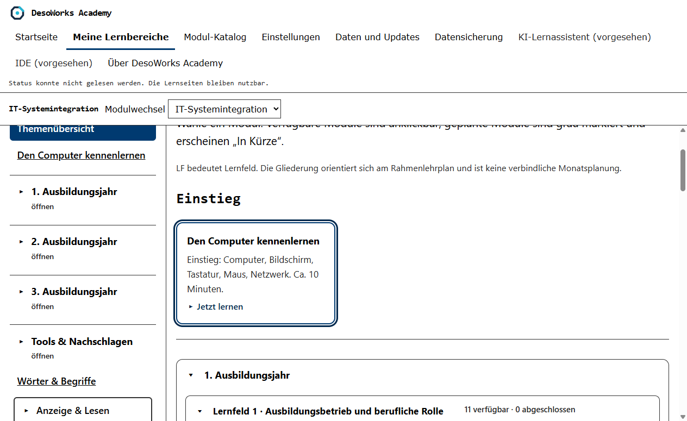
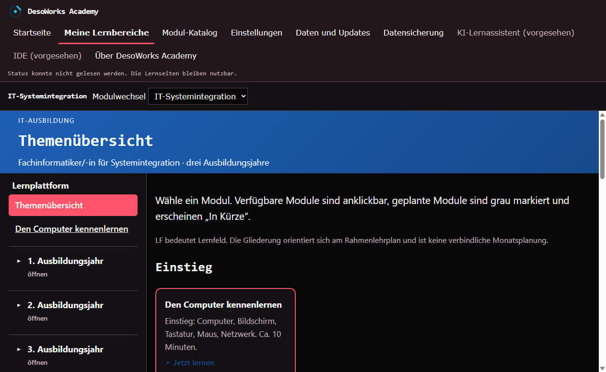

# Design Harmony – Kontrast der Themenübersicht

**Stand:** 22.11.2026  
**Status:** Ursache belegt, Token-Korrektur im Quellstand geprüft. Keine Installation, kein Release, keine WCAG-Freigabe.

## Beobachtung

In der installierten Academy `0.3.1-dev.6` sind die Links „Jetzt lernen“ kaum lesbar. Betroffen sind Einstiegskarten und Lernfeldkarten. Die Academy steht auf Dunkel.

Die laufende Installation wurde nicht verändert. Gemessen wurde eine Kopie der installierten Moduldateien in einem temporären Academy-Profil.

## Ursache

Die installierte App lädt nicht das mitgelieferte Modul, sondern das Paket `desoworks.it-systemintegration` **1.0.2** aus dem Benutzerprofil. Dessen `anzeige-glossar.js` kennt `data-academy-theme` nicht und setzt `data-theme` aus dem eigenen Speicher, Standard `hell`.

Die Academy-Shell setzt trotzdem `data-academy-theme="dunkel"`. Die Rollenmatrix färbt damit Fläche und Text um, aber nicht `--farbe-akzent-dunkel`. Der Link bleibt auf dem Hellmodus-Wert `#164a8c`.

Gemessen vor der Korrektur, installierte Moduldateien im Academy-iframe, Dunkel:

| Fläche | Text „Jetzt lernen“ | Kontrast |
| --- | --- | --- |
| `rgb(20, 17, 20)` / `#141114` | `rgb(22, 74, 140)` / `#164a8c` | **2,14:1** |

Dieselbe Farbe auf Einstiegskarte und Lernfeldkarte. WCAG 2.2 AA für normalen Text verlangt 4,5:1. Der Wert liegt darunter.

Die Fläche ist die dunkle Knight-Fläche, nicht Weiß. Der Link trägt die Farbe, die für einen hellen Hintergrund gedacht ist. Deshalb verschwindet er auf der dunklen Karte. Die Formulierung „heller Hintergrund“ trifft den gemessenen Kartengrund nicht. Der gemessene Fehler ist Marineblau auf Knight-Dunkel.

Hell und Kontrast der installierten Dateien lagen vor der Korrektur bei 8,78:1, weil dort Fläche und Linkfarbe noch zusammenpassten. Kontrastmodus der Academy kam im Modul nicht an: `data-theme` blieb `hell`.

## Korrektur

Geändert ist nur die gemeinsame Rollenmatrix in `src/renderer/design-tokens.css`. Keine neue Farbe. Keine Änderung an Lernstand, Update, App-ID oder Modulgrenzen.

Dunkel aliasiert die fehlenden Rollen auf vorhandene `--dw-*`-Token:

- `--farbe-akzent-dunkel` → `--dw-accent` (`#FF5369`)
- `--farbe-hover-flaeche` → `--dw-surface-raised`
- `--farbe-aktiv-tekst` → `--dw-on-accent`
- `--farbe-kontroll-flaeche` → `--dw-surface-raised`
- `--farbe-kontroll-text` → `--dw-text`
- `--farbe-geplant-flaeche` → `--dw-surface`
- `--farbe-geplant-tekst` → `--dw-text-muted`

Hell und Kontrast setzen dieselben Rollen auf die bereits vorhandenen Modulwerte. Die Spezifität `:root[data-academy-theme]` schlägt `html[data-theme]`. Ein Modul, das intern auf Hell stehen bleibt, kann die Academy-Farben damit nicht mehr mit der alten Linkfarbe überschreiben.

`tests/design-harmony-2b-theme.test.js` prüft die erweiterten Rollen. Lauf: 23 bestanden, 0 fehlgeschlagen, Exit 0.

## Gerenderte Prüfung

Electron-Academy, temporäres Profil, Modul im iframe. Nicht die Installation des Commanders.

Nach der Korrektur, installierte 1.0.2-Webdateien und Quellmodul, gleiche Messwerte:

| Modus | „Jetzt lernen“ | Fläche | Kontrast | Fokus |
| --- | --- | --- | --- | --- |
| Dunkel | `rgb(255, 83, 105)` | `rgb(20, 17, 20)` | 5,98:1 | `solid 3px rgb(255, 83, 105)`, `:focus-visible` |
| Hell | `rgb(22, 74, 140)` | `rgb(255, 255, 255)` | 8,78:1 | `solid 3px rgb(22, 74, 140)`, `:focus-visible` |
| Kontrast | `rgb(0, 40, 77)` | `rgb(255, 255, 255)` | 14,89:1 | `solid 3px rgb(0, 40, 77)`, `:focus-visible` |

Navigation „Themenübersicht“ im Dunkelmodus: Text `rgb(22, 6, 10)` auf `rgb(255, 83, 105)`, 6,29:1. Geplante Lektion „In Kürze“: 9,77:1. Fließtext der Seite: 18,42:1.

Vorher, installierte Moduldateien, Dunkel: „Jetzt lernen“ bei 2,14:1.

## Nicht belegt

- Zeiger-Hover hat die Karte nicht getroffen. Der Hover-Token ist gesetzt (`#FF5369` auf `#24171C`, rechnerisch 5,51:1). Das ist keine gerenderte Hover-Prüfung.
- Kein Screenreader.
- Kein 150-%- oder 200-%-Zoom in diesem Lauf.
- Kein abgeschlossenes Häkchen in der gerenderten Übersicht. Die Markierung bleibt hart `#176b32` / `#fff` und folgt den Tokens nicht. Weiß auf diesem Grün ist rechnerisch 6,59:1, nicht als Seitenbefund gemessen.
- Modul 1.0.2 zeigt weiter eine eigene Darstellungswahl. Der Quellstand schaltet sie in der Academy ab. Das installierte Paket hat diese Skriptänderung nicht.
- Die laufende `0.3.1-dev.6` enthält die alte Rollenmatrix. Die Korrektur wirkt dort erst nach einem neuen Core-Build. Es gab keinen Push und keine Installation.

Keine Produktionsfreigabe. Keine WCAG-Konformität.
